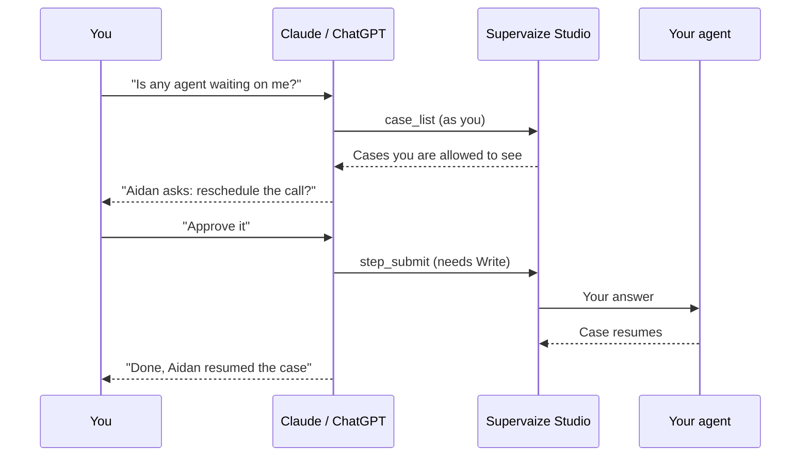

import ChatReplay from "@site/src/components/McpDemo/ChatReplay";

# Supervaize MCP: example usage

Once [the connector is installed](./install), talk to your workspace in plain language. Pick a conversation below and watch which tools the assistant calls.

<ChatReplay />

## Prompts to try

Copy any of these into Claude or ChatGPT.

### See what is going on (read)

- _What is running in my Supervaize workspace?_
- _Which missions have active jobs, and who is assigned to them?_
- _How did the Customer Voice mission do over the last 30 days? Cases by status and total cost._
- _Show me the steps of the last failed case and tell me where it went wrong._
- _Which agents are online?_
- _How is the workspace doing this month?_ See [Analytics](#analytics).
- _Show me every comment I have not read yet._ See [Comments](#comments).

### Unblock an agent (write)

- _Is any agent waiting on me?_
- _Show me the question on that case, then approve it._

The assistant reads the pending human-in-the-loop step, shows you the question, and submits **your** answer with `step_submit`. The agent resumes at once.

### Launch work (write)

- _Create a mission called "Q4 Check-ins" and assign Aidan to it._
- _Start a new job for Aidan in the Onboarding Check-ins mission._

Creating a job is always two-phase: the assistant first calls `job_setup` in **preview** mode and shows what it would create. Nothing starts until you confirm.

### Organise and manage (write)

- _Tag these 12 cases "needs-review"._ See [Tags](#tags).
- _Rate the Customer Voice mission 4 out of 5 for clarity._ See [Ratings](#ratings).
- _Rename the Q4 Check-ins mission and set its end date._ See [Missions](#missions).
- _Stop the March cohort job._ See [Jobs](#jobs).

:::tip[Write a weekly report in one prompt]
_Every Monday I want a status of all in-progress missions: cases completed last week, cost, and anything awaiting input. Write it as a short email to my team._ The assistant chains `mission_list`, `mission_stats` and `case_list` on its own.
:::

## How a request flows

## Vocabulary

| Term | Meaning |
| --- | --- |
| **Mission** | Groups the work of one or more agents |
| **Job** | One agent run inside a mission |
| **Case** | The agent's unit of work inside a job, for example one interview or one ticket |
| **Step** | One ordered event of a case; some steps wait for a human answer |
| **Tag** | A short label on a mission, job, case or step, used to group and find work |
| **Comment** | A message in the discussion thread of a mission, job, case or step |
| **Rating** | Your score of an agent, mission, job or case, on the dimensions your workspace offers |

## Usage patterns

Each pattern shows what you type, which tools the assistant calls, what comes back, and the access rule that applies. The wording of your request does not matter; the assistant finds the right tools. Data in the examples is fictional.

:::info[Actions that cannot be undone]
`tags_set`, `comment_delete`, `mission_archive`, `mission_delete`, `job_stop` and `job_delete` are flagged as destructive, so Claude and ChatGPT usually ask you to confirm before running them. Each client decides how it asks. `job_start`, `job_stop` and `job_complete` also make the agent work, so check the request before you confirm.
:::

### Tags

Tags are free-text labels. Missions, jobs and cases in list results now carry their `tags`.

<ChatReplay only="tags" />

#### Tag many cases in one call

- **You say:** _Tag the 12 cases from last week's interview batch "needs-review"._
- **Assistant calls:** `case_list` to find the cases, then `tags_set` with `kind: case`, `ids` (1 to 100 ids), `tags: ["needs-review"]` and `mode: add`.
- **Comes back:** one result per case. Each case succeeds or fails on its own, so a partial failure is normal: "11 tagged, 1 failed". The failed case says why, for example that you may not tag on its mission.
- **Rule:** `mode` is `replace` (the default, sets exactly these tags), `add` (keeps the current tags) or `remove`. A tag has up to 100 characters and no comma; an object holds up to 20 tags. Tags on a job, case or step need the **Tag** switch on the mission. Tags on a mission need the right to manage it. A tag that a case scope uses on a case can change only for mission managers.

#### Find tagged work

- **You say:** _What is tagged "needs-review" in Customer Voice? Which tags do we use?_
- **Assistant calls:** `tag_list` (optionally with `q` to narrow by text), then `case_list` or `job_list` with `tag: "needs-review"`. `case_list` also accepts `mission_id`.
- **Comes back:** `tag_list` gives tag names. The lists give only the rows that carry the tag, each with its full set of tags.
- **Rule:** `tag_list` shows only tags on missions you can see, and on their jobs, cases and steps.

### Comments

Comment tools work only when the **Comments** feature is switched on for the workspace.

<ChatReplay only="comments" />

#### Read one thread, post, edit or delete

- **You say:** _What did the team say on the Rivera case? Reply that the call is rescheduled._
- **Assistant calls:** `comment_list` with `kind: case` and `id`, then `comment_add` with `kind`, `id` and `body` (1 to 5000 characters).
- **Comes back:** the thread, oldest first. After the reply, confirmation that the comment is posted.
- **Rule:** you can comment on anything you can see, unless you are a read-only member.

To fix or remove your own comment, say so: _Fix the typo in my last comment on that case._ The assistant finds it with `comment_list`, then calls `comment_update` with `comment_id` and the new `body`; the comment shows as edited. `comment_delete` removes it for good. Only the author can edit or delete a comment.

#### Collect every comment you can see

- **You say:** _Summarise the comments I have not read in Customer Voice since Monday._
- **Assistant calls:** `comment_list` without `id`, with filters: `mission_id`, `kind` (`mission`, `job`, `case` or `step`), `unread_only`, `mine_only` and `since` (an ISO 8601 date and time). It reads further pages with `limit` (up to 100) and `offset`.
- **Comes back:** a flat list, newest first. Each row names its target and its mission, so the assistant can group and summarise.
- **Rule:** the list holds only comments on objects you can see in Studio.

#### How the read marker works

Each user has their own read marker. It never changes what other people see.

- Reading **one thread** with `comment_list` marks that thread as read for you, as the web app does.
- Reading the **feed** (no `id`) marks nothing. The same unread comments come back next time.
- `comment_add` does not mark the thread as read either.
- `comment_mark_seen` marks one thread (`kind` and `id`) or, with no arguments, every thread you can see. It answers how many threads it marked. It needs the Write permission, so read-only members can read comments but cannot mark them read.

### Ratings

A **rating** scores an agent, mission, job or case on dimensions that your workspace defines, for example "clarity". Ratings can be turned off per target.

<ChatReplay only="ratings" />

#### See what can be rated, then rate it

- **You say:** _Rate the Customer Voice mission 4 out of 5 for clarity._
- **Assistant calls:** `rating_get` with `kind: mission` and `id` (kinds are `agent`, `mission`, `job` and `case`), then `rating_set` with `data: {"clarity": 4}`.
- **Comes back:** `rating_get` lists the dimensions offered, your current rating and whether you may rate. An empty list of dimensions means ratings are off there. `rating_set` saves your rating.
- **Rule:** you need the **Rate** switch on the mission (workspace-wide for an agent). `rating_set` replaces your whole previous rating, and dimensions that are not offered are dropped.

| Dimension type | Accepted value |
| --- | --- |
| Thumbs | `-1` or `1` |
| Stars (5) | whole number from 1 to 5 |
| Score (10) | whole number from 1 to 10 |
| Comment | text, up to 2000 characters |

#### Collect all ratings you can see

- **You say:** _Show every rating on Customer Voice since the start of the month._
- **Assistant calls:** `rating_list` with `mission_id` and `since`. Other filters: `kind` and `mine_only`; pages with `limit` and `offset`.
- **Comes back:** rows newest first, each with the target, the mission, who rated, whether it is yours (`is_mine`), the values and the update time.
- **Rule:** your own ratings always appear. Ratings by other users appear only on missions where the **View rating results** switch is on for you, and only while that rating is still offered. If a manager switches a rating off, its old ratings go private again. For agents, the permission applies workspace-wide.

### Missions

#### Rename or re-plan

- **You say:** _Rename Q4 Check-ins to "Q4 Check-ins EMEA", set it to high priority and end it on 15 December._
- **Assistant calls:** `mission_list` to find it, then `mission_update` with `mission_id` and only the fields to change: `name`, `description`, `status`, `priority`, `budget`, `start_date`, `end_date`, `progress`, `agent_slugs`, `user_ids`.
- **Comes back:** confirmation of the change.
- **Rule:** you need the right to manage the mission. `agent_slugs` and `user_ids` replace the whole list, so the assistant should send the full list. It does not call the agent.

#### Clone

- **You say:** _Copy Onboarding Check-ins for the April cohort._
- **Assistant calls:** `mission_clone` with `mission_id`, then optionally `mission_update` to rename the copy.
- **Comes back:** a new mission named "Onboarding Check-ins (Copy)". Agents, members and mission permissions are kept. Jobs, tags and progress are not copied.
- **Rule:** the right to manage the mission.

#### Archive or delete

- **You say:** _Get rid of the Churn Interviews mission._
- **Assistant calls:** `mission_delete` if it is a draft with no jobs, otherwise `mission_archive`. Each tool refuses the other's case and names the right tool.
- **Comes back:** confirmation. An archived mission leaves the active list. A deleted mission is gone for good.
- **Rule:** archive is for missions that have jobs or are past draft, and this connector cannot undo it. Delete works only on a draft without jobs and cannot be undone. Both need the right to manage the mission.

### Jobs

Stopping a job is flagged as destructive, so the chat app asks first. This replay stops a job and renames its mission.

<ChatReplay only="manage" />

| Request | Tool | Calls the agent | Destructive |
| --- | --- | --- | --- |
| Edit name, description, input fields or instructions | `job_update` | No | No |
| Start a stopped job | `job_start` | Yes | No |
| Stop a running job | `job_stop` | Yes, for v2 agents | Yes |
| Mark a running or awaiting job complete | `job_complete` | Yes, for v2 agents | No |
| Copy a job | `job_clone` | No | No |
| Delete a job | `job_delete` | No | Yes |

- **You say:** _Stop the March cohort job, then start it again with the new instructions._
- **Assistant calls:** `job_list` or `job_get` to find it, `job_stop` with `job_id`, `job_update` with `instructions`, then `job_start`. Stop, complete and start accept an `idempotency_key`: a retry with the same key does not run the action twice. `job_start` also accepts `rule_controls`, the rule choices for this run.
- **Comes back:** the job as it is now.
- **Rule:** start, stop, complete and edit need the **Operate jobs** switch on the mission. A participant with a limited case scope can change only the jobs they started. `job_start` is refused when the agent server is offline, when the job is not stopped, or when the agent has no workspace grant. Work the agent already did is not undone by `job_stop`.

Two more rules to know:

- `job_clone` makes a new stopped job in the same mission. It needs the right to manage the mission. Jobs of v2 agents cannot be cloned: start a new job with `job_setup` instead.
- `job_delete` deletes the job for good and needs the right to manage the mission. If other records still refer to the job, Studio deactivates it instead, and the answer says so.

### Analytics

<ChatReplay only={["dashboard", "pending"]} />

#### How is the workspace doing

- **You say:** _How is the workspace doing this month?_
- **Assistant calls:** `dashboard`, optionally with `sections: ["summary"]` or `["insights"]`. The default is both.
- **Comes back:** counts of agents, missions and jobs, recent jobs, and the insights from the Studio home page: key figures, monthly cost, top agents, weekly activity and your cases of the last 7 days.
- **Rule:** counts cover only missions and cases you can see. Where you may not view costs, the cost is empty. Agent counts are workspace-wide, as in Studio.

#### One agent's volumes

- **You say:** _How many jobs and cases did Aidan handle in the last 90 days?_
- **Assistant calls:** `agent_stats` with `agent_slug: aidan` and `days: 90` (1 to 365, default 30). If the slug is ambiguous it uses `agent_id`.
- **Comes back:** the agent's jobs and cases by status and per day. No cost, no ratings; use `mission_stats` for cost.
- **Rule:** you need the permission to manage agents. The numbers cover only missions you can see, so they can be lower than the agent's workspace totals.

#### What waits for my input

- **You say:** _What is waiting for my input? Approve the first one._
- **Assistant calls:** `pending_actions` (optionally with `limit`, up to 100), shows you the question, then `step_submit` with `step_id`, `case_id` and your `response`.
- **Comes back:** the cases waiting for a human, oldest first, each with its job, mission, the awaiting step and `can_submit`. Counts for each group of the Studio actions panel come with it. After `step_submit`, the agent resumes.
- **Rule:** `can_submit` is true only where the **Reply to human-in-the-loop** switch lets you answer. Cases you skipped in Studio are left out.

## What you can and cannot see

The assistant works as you. Every tool applies the same rules as Studio: your workspace role, the missions you can see, a participant's case scope and the switches of each mission.

<ChatReplay only="access" />

- **Hidden means not found.** On the tag, comment, rating, mission, job and analytics tools, an object you cannot see answers "Requested entity not found". The call is refused and no data of that mission is returned, so an id from a mission you cannot see reveals nothing.
- **Read-only members cannot write.** Write tools are refused for read-only members. They are also refused when the connection was approved with **Read** only, whatever your role.
- **Mission switches apply to each tool.**

  | Switch | What it controls |
  | --- | --- |
  | **Tag** | `tags_set` on jobs, cases and steps |
  | **Rate** | `rating_set` |
  | **View rating results** | Other users' ratings in `rating_get` and `rating_list` |
  | **Operate jobs** | `job_start`, `job_stop`, `job_complete`, `job_update` |
  | **Reply to human-in-the-loop** | `step_submit`, and `can_submit` in `pending_actions` |
  | **View costs** | Cost figures in `dashboard` and the other tools |

- **Costs stay hidden** on a mission where **View costs** is off. No tool shows them.
- **Managing needs a manager.** Mission tools, tags on a mission, `job_clone` and `job_delete` need the right to manage the mission.

## Tool reference

You never call these tools yourself; the assistant picks them. **Write** tools need the Write permission granted at connection time and the matching role in Studio.

| Tool | What it does | Access |
| --- | --- | --- |
| `workspace_info` | Connected workspace, your roles, granted permissions | Read |
| `agent_list` | Agents in the workspace and their status | Read |
| `catalog` | Data resources and analytics each agent declares | Read |
| `mission_list` / `mission_get` | Browse the missions you can see | Read |
| `mission_stats` | Jobs and cases by status, cost, activity per day | Read |
| `job_list` / `job_get` | Browse jobs, their cases and the agent's actions; `job_list` filters by tag | Read |
| `case_list` / `case_get` | Browse cases and their ordered steps; `case_list` filters by tag and mission | Read |
| `resource_list` / `resource_get` | Items of an agent-declared data resource (sensitive fields masked) | Read |
| `artifact_get` | Fetch a deliverable attached to a step | Read |
| `mission_create` | Create a mission, optionally assigning agents | Write |
| `job_setup` | Create a job for an agent: preview, then confirm | Write |
| `step_submit` | Answer a human-in-the-loop step | Write |
| `agent_action_invoke` | Run an action the agent declares on a job | Write |
| `job_sync` | Reconcile a job with its agent after a network hiccup | Write |
| `tag_list` | Tag names used on the missions, jobs, cases and steps you can see | Read |
| `tags_set` | Replace, add or remove tags on 1 to 100 missions, jobs, cases or steps; each object is checked on its own | Write |
| `comment_list` | One thread (marks it read for you) or the feed of every comment you can see | Read |
| `comment_add` / `comment_update` / `comment_delete` | Write a comment; change or delete your own | Write |
| `comment_mark_seen` | Mark one thread, or every thread you can see, as read | Write |
| `rating_get` / `rating_set` | The rating dimensions and your rating of an agent, mission, job or case; save your rating | Read / Write |
| `rating_list` | Every rating you can see: yours, and other users' where you may view rating results | Read |
| `mission_update` | Change a mission's name, description, status, priority, budget, dates, progress, agents or participants | Write |
| `mission_archive` / `mission_delete` | Archive a mission that has jobs; permanently delete a draft mission without jobs | Write |
| `mission_clone` | Duplicate a mission | Write |
| `job_update` | Change a job's name, description, input fields or instructions | Write |
| `job_start` / `job_stop` / `job_complete` | Start a stopped job, stop a job, mark a job complete. These call the agent | Write |
| `job_clone` / `job_delete` | Duplicate a job; permanently delete a job (deactivated instead when other records still refer to it) | Write |
| `dashboard` | Workspace counts, key figures, monthly cost, top agents and weekly activity, from the missions you can see | Read |
| `agent_stats` | Jobs and cases of one agent by status and per day. Needs the permission to manage agents | Read |
| `pending_actions` | Cases that wait for human input, with the step to answer and whether you may answer it | Read |

## Good to know

- **Same rights as in Studio.** See [What you can and cannot see](#what-you-can-and-cannot-see). Comment tools need the Comments feature on the workspace.
- **Deletes are permanent.** `comment_delete`, `mission_delete` and `job_delete` cannot be undone.
- **Sensitive fields stay masked** in data resources unless your role can configure agent parameters.
- **Every call is logged** with the tool name and who made it. Argument values and responses are not stored.
- **Sessions last.** The assistant refreshes its access silently; after 30 days without use you sign in again.
