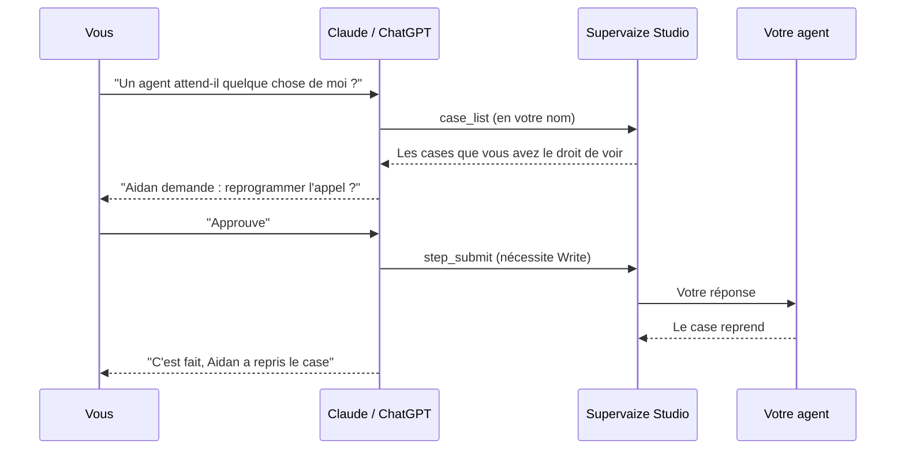

import ChatReplay from "@site/src/components/McpDemo/ChatReplay";

# Supervaize MCP : exemples d'utilisation {#supervaize-mcp-example-usage}

Une fois [le connecteur installé](./install), parlez à votre espace de travail en langage courant. Choisissez une conversation ci-dessous et regardez quels outils l'assistant appelle.

<ChatReplay />

## Demandes à essayer {#prompts-to-try}

Copiez n'importe laquelle de ces demandes dans Claude ou ChatGPT.

### Voir ce qui se passe (lecture) {#see-what-is-going-on-read}

- _Qu'est-ce qui est en cours dans mon espace de travail Supervaize ?_
- _Quelles missions ont des jobs actifs, et qui y est affecté ?_
- _Comment s'est comportée la mission Customer Voice sur les 30 derniers jours ? Les cases par statut et le coût total._
- _Montre-moi les étapes du dernier case en échec et dis-moi où cela s'est mal passé._
- _Quels agents sont en ligne ?_
- _Comment va l'espace de travail ce mois-ci ?_ Voir [Analyses](#analytics).
- _Montre-moi tous les commentaires que je n'ai pas encore lus._ Voir [Commentaires](#comments).

### Débloquer un agent (écriture) {#unblock-an-agent-write}

- _Un agent attend-il quelque chose de moi ?_
- _Montre-moi la question sur ce case, puis approuve-la._

L'assistant lit l'étape de validation humaine en attente, vous montre la question, et soumet **votre** réponse avec `step_submit`. L'agent reprend aussitôt.

### Lancer un travail (écriture) {#launch-work-write}

- _Crée une mission appelée « Q4 Check-ins » et affecte-lui Aidan._
- _Démarre un nouveau job pour Aidan dans la mission Onboarding Check-ins._

La création d'un job se fait toujours en deux temps : l'assistant appelle d'abord `job_setup` en mode **preview** et montre ce qu'il créerait. Rien ne démarre tant que vous ne confirmez pas.

### Organiser et gérer (écriture) {#organise-and-manage-write}

- _Ajoute le tag « needs-review » à ces 12 cases._ Voir [Tags](#tags).
- _Donne 4 sur 5 en clarté à la mission Customer Voice._ Voir [Évaluations](#ratings).
- _Renomme la mission Q4 Check-ins et fixe sa date de fin._ Voir [Missions](#missions).
- _Arrête le job de la cohorte de mars._ Voir [Jobs](#jobs).

:::tip[Rédigez un rapport hebdomadaire en une seule demande]
_Chaque lundi, je veux un état de toutes les missions en cours : les cases terminés la semaine dernière, le coût, et tout ce qui attend une réponse. Rédige-le sous la forme d'un court e-mail à mon équipe._ L'assistant enchaîne de lui-même `mission_list`, `mission_stats` et `case_list`.
:::

## Le parcours d'une demande {#how-a-request-flows}

## Vocabulaire {#vocabulary}

| Terme | Signification |
| --- | --- |
| **Mission** | Regroupe le travail d'un ou de plusieurs agents |
| **Job** | Une exécution d'un agent à l'intérieur d'une mission |
| **Case** | L'unité de travail de l'agent à l'intérieur d'un job, par exemple un entretien ou un ticket |
| **Étape** (step) | Un événement ordonné d'un case ; certaines étapes attendent une réponse humaine |
| **Tag** | Une courte étiquette sur une mission, un job, un case ou une étape, qui sert à regrouper et à retrouver le travail |
| **Commentaire** (comment) | Un message dans le fil de discussion d'une mission, d'un job, d'un case ou d'une étape |
| **Évaluation** (rating) | Votre note sur un agent, une mission, un job ou un case, selon les dimensions que propose votre espace de travail |

## Modèles d'usage {#usage-patterns}

Chaque modèle montre ce que vous saisissez, quels outils l'assistant appelle, ce qui revient, et la règle d'accès qui s'applique. La formulation de votre demande n'a pas d'importance ; l'assistant trouve les bons outils. Les données des exemples sont fictives.

:::info[Actions qui ne peuvent pas être annulées]
`tags_set`, `comment_delete`, `mission_archive`, `mission_delete`, `job_stop` et `job_delete` sont signalés comme destructifs : Claude et ChatGPT vous demandent donc généralement de confirmer avant de les exécuter. Chaque client décide de la façon dont il le demande. `job_start`, `job_stop` et `job_complete` font aussi travailler l'agent, vérifiez donc la demande avant de confirmer.
:::

### Tags {#tags}

Les tags sont des étiquettes en texte libre. Les missions, les jobs et les cases portent désormais leurs `tags` dans les résultats de liste.

<ChatReplay only="tags" />

#### Ajouter un tag à de nombreux cases en un seul appel {#tag-many-cases-in-one-call}

- **Vous dites :** _Ajoute le tag « needs-review » aux 12 cases du lot d'entretiens de la semaine dernière._
- **L'assistant appelle :** `case_list` pour trouver les cases, puis `tags_set` avec `kind: case`, `ids` (1 à 100 identifiants), `tags: ["needs-review"]` et `mode: add`.
- **En retour :** un résultat par case. Chaque case réussit ou échoue indépendamment, un échec partiel est donc normal : « 11 tagués, 1 en échec ». Le case en échec dit pourquoi, par exemple que vous n'avez pas le droit d'ajouter des tags sur sa mission.
- **Règle :** `mode` vaut `replace` (la valeur par défaut, qui fixe exactement ces tags), `add` (qui garde les tags actuels) ou `remove`. Un tag compte au plus 100 caractères et aucune virgule ; un objet porte au plus 20 tags. Les tags sur un job, un case ou une étape nécessitent l'option **Tag** sur la mission. Les tags sur une mission nécessitent le droit de la gérer. Un tag qu'un périmètre de cases utilise sur un case ne peut être modifié que par les responsables de la mission.

#### Retrouver le travail tagué {#find-tagged-work}

- **Vous dites :** _Qu'est-ce qui porte le tag « needs-review » dans Customer Voice ? Quels tags utilisons-nous ?_
- **L'assistant appelle :** `tag_list` (éventuellement avec `q` pour filtrer par texte), puis `case_list` ou `job_list` avec `tag: "needs-review"`. `case_list` accepte aussi `mission_id`.
- **En retour :** `tag_list` donne les noms des tags. Les listes ne donnent que les lignes qui portent le tag, chacune avec son jeu complet de tags.
- **Règle :** `tag_list` ne montre que les tags des missions que vous pouvez voir, et ceux de leurs jobs, cases et étapes.

### Commentaires {#comments}

Les outils de commentaires ne fonctionnent que lorsque la fonctionnalité **Comments** est activée pour l'espace de travail.

<ChatReplay only="comments" />

#### Lire un fil, publier, modifier ou supprimer {#read-one-thread-post-edit-or-delete}

- **Vous dites :** _Qu'a dit l'équipe sur le case Rivera ? Réponds que l'appel est reprogrammé._
- **L'assistant appelle :** `comment_list` avec `kind: case` et `id`, puis `comment_add` avec `kind`, `id` et `body` (1 à 5000 caractères).
- **En retour :** le fil, du plus ancien au plus récent. Après la réponse, la confirmation que le commentaire est publié.
- **Règle :** vous pouvez commenter tout ce que vous pouvez voir, sauf si vous êtes un membre en lecture seule.

Pour corriger ou retirer votre propre commentaire, dites-le : _Corrige la faute de frappe dans mon dernier commentaire sur ce case._ L'assistant le trouve avec `comment_list`, puis appelle `comment_update` avec `comment_id` et le nouveau `body` ; le commentaire apparaît comme modifié. `comment_delete` le supprime définitivement. Seul l'auteur peut modifier ou supprimer un commentaire.

#### Rassembler tous les commentaires que vous pouvez voir {#collect-every-comment-you-can-see}

- **Vous dites :** _Résume les commentaires que je n'ai pas lus dans Customer Voice depuis lundi._
- **L'assistant appelle :** `comment_list` sans `id`, avec des filtres : `mission_id`, `kind` (`mission`, `job`, `case` ou `step`), `unread_only`, `mine_only` et `since` (une date et une heure au format ISO 8601). Il lit les pages suivantes avec `limit` (jusqu'à 100) et `offset`.
- **En retour :** une liste à plat, du plus récent au plus ancien. Chaque ligne nomme sa cible et sa mission, l'assistant peut donc regrouper et résumer.
- **Règle :** la liste ne contient que les commentaires portant sur des objets que vous pouvez voir dans Studio.

#### Comment fonctionne le marqueur de lecture {#how-the-read-marker-works}

Chaque utilisateur a son propre marqueur de lecture. Il ne change jamais ce que voient les autres.

- Lire **un fil** avec `comment_list` marque ce fil comme lu pour vous, comme le fait l'application web.
- Lire le **flux** (sans `id`) ne marque rien. Les mêmes commentaires non lus reviennent la fois suivante.
- `comment_add` ne marque pas non plus le fil comme lu.
- `comment_mark_seen` marque un fil (`kind` et `id`) ou, sans argument, tous les fils que vous pouvez voir. Il répond avec le nombre de fils marqués. Il nécessite la permission Write : les membres en lecture seule peuvent donc lire les commentaires, mais pas les marquer comme lus.

### Évaluations {#ratings}

Une **évaluation** note un agent, une mission, un job ou un case selon des dimensions que définit votre espace de travail, par exemple « clarté ». Les évaluations peuvent être désactivées pour chaque cible.

<ChatReplay only="ratings" />

#### Voir ce qui peut être évalué, puis l'évaluer {#see-what-can-be-rated-then-rate-it}

- **Vous dites :** _Donne 4 sur 5 en clarté à la mission Customer Voice._
- **L'assistant appelle :** `rating_get` avec `kind: mission` et `id` (les types sont `agent`, `mission`, `job` et `case`), puis `rating_set` avec `data: {"clarity": 4}`.
- **En retour :** `rating_get` liste les dimensions proposées, votre évaluation actuelle et si vous avez le droit d'évaluer. Une liste de dimensions vide signifie que les évaluations y sont désactivées. `rating_set` enregistre votre évaluation.
- **Règle :** vous avez besoin de l'option **Rate** sur la mission (à l'échelle de l'espace de travail pour un agent). `rating_set` remplace toute votre évaluation précédente, et les dimensions qui ne sont pas proposées sont ignorées.

| Type de dimension | Valeur acceptée |
| --- | --- |
| Pouces | `-1` ou `1` |
| Étoiles (5) | nombre entier de 1 à 5 |
| Score (10) | nombre entier de 1 à 10 |
| Commentaire | texte, jusqu'à 2000 caractères |

#### Rassembler toutes les évaluations que vous pouvez voir {#collect-all-ratings-you-can-see}

- **Vous dites :** _Montre toutes les évaluations sur Customer Voice depuis le début du mois._
- **L'assistant appelle :** `rating_list` avec `mission_id` et `since`. Autres filtres : `kind` et `mine_only` ; pagination avec `limit` et `offset`.
- **En retour :** les lignes, de la plus récente à la plus ancienne, chacune avec la cible, la mission, l'auteur de l'évaluation, si elle est la vôtre (`is_mine`), les valeurs et l'heure de mise à jour.
- **Règle :** vos propres évaluations apparaissent toujours. Les évaluations des autres utilisateurs n'apparaissent que sur les missions où l'option **View rating results** est activée pour vous, et seulement tant que cette évaluation est encore proposée. Si un responsable désactive une évaluation, ses anciennes évaluations redeviennent privées. Pour les agents, la permission s'applique à l'échelle de l'espace de travail.

### Missions {#missions}

#### Renommer ou replanifier {#rename-or-re-plan}

- **Vous dites :** _Renomme Q4 Check-ins en « Q4 Check-ins EMEA », passe-la en priorité haute et termine-la le 15 décembre._
- **L'assistant appelle :** `mission_list` pour la trouver, puis `mission_update` avec `mission_id` et seulement les champs à modifier : `name`, `description`, `status`, `priority`, `budget`, `start_date`, `end_date`, `progress`, `agent_slugs`, `user_ids`.
- **En retour :** la confirmation de la modification.
- **Règle :** vous avez besoin du droit de gérer la mission. `agent_slugs` et `user_ids` remplacent toute la liste, l'assistant doit donc envoyer la liste complète. L'outil n'appelle pas l'agent.

#### Cloner {#clone}

- **Vous dites :** _Copie Onboarding Check-ins pour la cohorte d'avril._
- **L'assistant appelle :** `mission_clone` avec `mission_id`, puis éventuellement `mission_update` pour renommer la copie.
- **En retour :** une nouvelle mission nommée « Onboarding Check-ins (Copy) ». Les agents, les membres et les permissions de la mission sont conservés. Les jobs, les tags et la progression ne sont pas copiés.
- **Règle :** le droit de gérer la mission.

#### Archiver ou supprimer {#archive-or-delete}

- **Vous dites :** _Débarrasse-moi de la mission Churn Interviews._
- **L'assistant appelle :** `mission_delete` si c'est un brouillon sans job, sinon `mission_archive`. Chaque outil refuse le cas de l'autre et nomme le bon outil.
- **En retour :** la confirmation. Une mission archivée quitte la liste active. Une mission supprimée disparaît définitivement.
- **Règle :** l'archivage concerne les missions qui ont des jobs ou qui ont dépassé l'état de brouillon, et ce connecteur ne peut pas l'annuler. La suppression ne fonctionne que sur un brouillon sans job et ne peut pas être annulée. Les deux nécessitent le droit de gérer la mission.

### Jobs {#jobs}

L'arrêt d'un job est signalé comme destructif, l'application de chat demande donc d'abord. Cette démonstration arrête un job et renomme sa mission.

<ChatReplay only="manage" />

| Demande | Outil | Appelle l'agent | Destructif |
| --- | --- | --- | --- |
| Modifier le nom, la description, les champs d'entrée ou les instructions | `job_update` | Non | Non |
| Démarrer un job arrêté | `job_start` | Oui | Non |
| Arrêter un job en cours | `job_stop` | Oui, pour les agents v2 | Oui |
| Marquer comme terminé un job en cours ou en attente | `job_complete` | Oui, pour les agents v2 | Non |
| Copier un job | `job_clone` | Non | Non |
| Supprimer un job | `job_delete` | Non | Oui |

- **Vous dites :** _Arrête le job de la cohorte de mars, puis redémarre-le avec les nouvelles instructions._
- **L'assistant appelle :** `job_list` ou `job_get` pour le trouver, `job_stop` avec `job_id`, `job_update` avec `instructions`, puis `job_start`. L'arrêt, la fin et le démarrage acceptent une `idempotency_key` : une nouvelle tentative avec la même clé n'exécute pas l'action deux fois. `job_start` accepte aussi `rule_controls`, les choix de règles pour cette exécution.
- **En retour :** le job tel qu'il est maintenant.
- **Règle :** démarrer, arrêter, terminer et modifier nécessitent l'option **Operate jobs** sur la mission. Un participant dont le périmètre de cases est limité ne peut modifier que les jobs qu'il a démarrés. `job_start` est refusé quand le serveur de l'agent est hors ligne, quand le job n'est pas arrêté, ou quand l'agent n'a pas d'autorisation dans l'espace de travail. `job_stop` n'annule pas le travail que l'agent a déjà fait.

Deux autres règles à connaître :

- `job_clone` crée un nouveau job arrêté dans la même mission. Il nécessite le droit de gérer la mission. Les jobs des agents v2 ne peuvent pas être clonés : démarrez plutôt un nouveau job avec `job_setup`.
- `job_delete` supprime le job définitivement et nécessite le droit de gérer la mission. Si d'autres enregistrements font encore référence au job, Studio le désactive à la place, et la réponse le dit.

### Analyses {#analytics}

<ChatReplay only={["dashboard", "pending"]} />

#### Comment va l'espace de travail {#how-is-the-workspace-doing}

- **Vous dites :** _Comment va l'espace de travail ce mois-ci ?_
- **L'assistant appelle :** `dashboard`, éventuellement avec `sections: ["summary"]` ou `["insights"]`. Par défaut, les deux.
- **En retour :** le nombre d'agents, de missions et de jobs, les jobs récents, et les analyses de la page d'accueil de Studio : chiffres clés, coût mensuel, agents les plus actifs, activité hebdomadaire et vos cases des 7 derniers jours.
- **Règle :** les décomptes ne couvrent que les missions et les cases que vous pouvez voir. Là où vous n'avez pas le droit de voir les coûts, le coût est vide. Le nombre d'agents porte sur tout l'espace de travail, comme dans Studio.

#### Les volumes d'un agent {#one-agents-volumes}

- **Vous dites :** _Combien de jobs et de cases Aidan a-t-il traités sur les 90 derniers jours ?_
- **L'assistant appelle :** `agent_stats` avec `agent_slug: aidan` et `days: 90` (1 à 365, 30 par défaut). Si le slug est ambigu, il utilise `agent_id`.
- **En retour :** les jobs et les cases de l'agent, par statut et par jour. Pas de coût, pas d'évaluations ; utilisez `mission_stats` pour le coût.
- **Règle :** vous avez besoin de la permission de gérer les agents. Les chiffres ne couvrent que les missions que vous pouvez voir, ils peuvent donc être inférieurs aux totaux de l'agent dans l'espace de travail.

#### Ce qui attend ma réponse {#what-waits-for-my-input}

- **Vous dites :** _Qu'est-ce qui attend ma réponse ? Approuve le premier._
- **L'assistant appelle :** `pending_actions` (éventuellement avec `limit`, jusqu'à 100), vous montre la question, puis `step_submit` avec `step_id`, `case_id` et votre `response`.
- **En retour :** les cases qui attendent un humain, du plus ancien au plus récent, chacun avec son job, sa mission, l'étape en attente et `can_submit`. Les décomptes de chaque groupe du panneau d'actions de Studio les accompagnent. Après `step_submit`, l'agent reprend.
- **Règle :** `can_submit` est vrai seulement là où l'option **Reply to human-in-the-loop** vous permet de répondre. Les cases que vous avez ignorés dans Studio sont laissés de côté.

## Ce que vous pouvez voir, et ce que vous ne pouvez pas voir {#what-you-can-and-cannot-see}

L'assistant travaille en votre nom. Chaque outil applique les mêmes règles que Studio : votre rôle dans l'espace de travail, les missions que vous pouvez voir, le périmètre de cases d'un participant et les options de chaque mission.

<ChatReplay only="access" />

- **Masqué veut dire introuvable.** Sur les outils de tags, de commentaires, d'évaluations, de missions, de jobs et d'analyses, un objet que vous ne pouvez pas voir répond « Requested entity not found ». L'appel est refusé et aucune donnée de cette mission n'est renvoyée : un identifiant venant d'une mission que vous ne pouvez pas voir ne révèle donc rien.
- **Les membres en lecture seule ne peuvent pas écrire.** Les outils d'écriture sont refusés aux membres en lecture seule. Ils sont aussi refusés quand la connexion a été approuvée avec **Read** uniquement, quel que soit votre rôle.
- **Les options de la mission s'appliquent à chaque outil.**

  | Option | Ce qu'elle contrôle |
  | --- | --- |
  | **Tag** | `tags_set` sur les jobs, les cases et les étapes |
  | **Rate** | `rating_set` |
  | **View rating results** | Les évaluations des autres utilisateurs dans `rating_get` et `rating_list` |
  | **Operate jobs** | `job_start`, `job_stop`, `job_complete`, `job_update` |
  | **Reply to human-in-the-loop** | `step_submit`, et `can_submit` dans `pending_actions` |
  | **View costs** | Les montants de coût dans `dashboard` et les autres outils |

- **Les coûts restent masqués** sur une mission où **View costs** est désactivé. Aucun outil ne les montre.
- **Gérer exige un responsable.** Les outils de mission, les tags sur une mission, `job_clone` et `job_delete` nécessitent le droit de gérer la mission.

## Référence des outils {#tool-reference}

Vous n'appelez jamais ces outils vous-même ; l'assistant les choisit. Les outils en **Écriture** nécessitent la permission Write accordée au moment de la connexion et le rôle correspondant dans Studio.

| Outil | Ce qu'il fait | Accès |
| --- | --- | --- |
| `workspace_info` | L'espace de travail connecté, vos rôles, les permissions accordées | Lecture |
| `agent_list` | Les agents de l'espace de travail et leur statut | Lecture |
| `catalog` | Les ressources de données et les analyses que chaque agent déclare | Lecture |
| `mission_list` / `mission_get` | Parcourir les missions que vous pouvez voir | Lecture |
| `mission_stats` | Les jobs et les cases par statut, le coût, l'activité par jour | Lecture |
| `job_list` / `job_get` | Parcourir les jobs, leurs cases et les actions de l'agent ; `job_list` filtre par tag | Lecture |
| `case_list` / `case_get` | Parcourir les cases et leurs étapes ordonnées ; `case_list` filtre par tag et par mission | Lecture |
| `resource_list` / `resource_get` | Les éléments d'une ressource de données déclarée par un agent (champs sensibles masqués) | Lecture |
| `artifact_get` | Récupérer un livrable attaché à une étape | Lecture |
| `mission_create` | Créer une mission, en lui affectant éventuellement des agents | Écriture |
| `job_setup` | Créer un job pour un agent : aperçu, puis confirmation | Écriture |
| `step_submit` | Répondre à une étape de validation humaine | Écriture |
| `agent_action_invoke` | Exécuter une action que l'agent déclare sur un job | Écriture |
| `job_sync` | Resynchroniser un job avec son agent après un incident réseau | Écriture |
| `tag_list` | Les noms des tags utilisés sur les missions, les jobs, les cases et les étapes que vous pouvez voir | Lecture |
| `tags_set` | Remplacer, ajouter ou retirer des tags sur 1 à 100 missions, jobs, cases ou étapes ; chaque objet est vérifié indépendamment | Écriture |
| `comment_list` | Un fil (le marque comme lu pour vous) ou le flux de tous les commentaires que vous pouvez voir | Lecture |
| `comment_add` / `comment_update` / `comment_delete` | Écrire un commentaire ; modifier ou supprimer le vôtre | Écriture |
| `comment_mark_seen` | Marquer comme lu un fil, ou tous les fils que vous pouvez voir | Écriture |
| `rating_get` / `rating_set` | Les dimensions d'évaluation et votre évaluation d'un agent, d'une mission, d'un job ou d'un case ; enregistrer votre évaluation | Lecture / Écriture |
| `rating_list` | Toutes les évaluations que vous pouvez voir : les vôtres, et celles des autres utilisateurs là où vous avez le droit de voir les résultats | Lecture |
| `mission_update` | Modifier le nom, la description, le statut, la priorité, le budget, les dates, la progression, les agents ou les participants d'une mission | Écriture |
| `mission_archive` / `mission_delete` | Archiver une mission qui a des jobs ; supprimer définitivement une mission à l'état de brouillon sans job | Écriture |
| `mission_clone` | Dupliquer une mission | Écriture |
| `job_update` | Modifier le nom, la description, les champs d'entrée ou les instructions d'un job | Écriture |
| `job_start` / `job_stop` / `job_complete` | Démarrer un job arrêté, arrêter un job, marquer un job comme terminé. Ces outils appellent l'agent | Écriture |
| `job_clone` / `job_delete` | Dupliquer un job ; supprimer définitivement un job (désactivé à la place quand d'autres enregistrements y font encore référence) | Écriture |
| `dashboard` | Les décomptes de l'espace de travail, les chiffres clés, le coût mensuel, les agents les plus actifs et l'activité hebdomadaire, à partir des missions que vous pouvez voir | Lecture |
| `agent_stats` | Les jobs et les cases d'un agent, par statut et par jour. Nécessite la permission de gérer les agents | Lecture |
| `pending_actions` | Les cases qui attendent une réponse humaine, avec l'étape à traiter et si vous avez le droit d'y répondre | Lecture |

## Bon à savoir {#good-to-know}

- **Les mêmes droits que dans Studio.** Voir [Ce que vous pouvez voir, et ce que vous ne pouvez pas voir](#what-you-can-and-cannot-see). Les outils de commentaires nécessitent la fonctionnalité Comments sur l'espace de travail.
- **Les suppressions sont définitives.** `comment_delete`, `mission_delete` et `job_delete` ne peuvent pas être annulés.
- **Les champs sensibles restent masqués** dans les ressources de données, sauf si votre rôle peut configurer les paramètres des agents.
- **Chaque appel est journalisé** avec le nom de l'outil et son auteur. Les valeurs des arguments et les réponses ne sont pas stockées.
- **Les sessions durent.** L'assistant renouvelle son accès en silence ; après 30 jours sans utilisation, vous vous connectez de nouveau.
